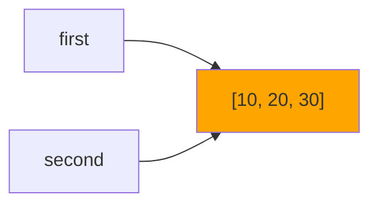
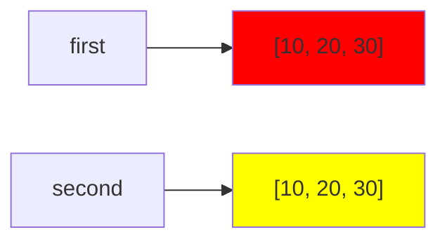

# Цель работы
Исследовать связь между именами и объектами, понять различия между присваиванием, поверхностным и глубоким копированием, а также познакомиться с механизмами управления памятью в CPython.

# Задание 1
  ## Эксперимент A
   ### Ожидаемый резултат: после выполнения инструкции a += 1 будет создан новый объект, поэтому id(a) поменяется
   ### Значение, связанное с именем b не изменилось, потому что при выполнении инструкции a += 1 в памяти был создан новый объект, так как int является неизменяемым типом
   #### 
  ## Эксперимент B
   ### Ожидаемый результат: после выполнения инструкции second.append(30) список first так же изменится
   #### 
   ### Дополнения
   #### 
   ### Схема связей между именами и объектами до переназначения

   ### Схема связей между именами и объектами после переназначения

 ## Практическая задача
 ### 

## Вопросы для анализа
 1. Меняет ли присваивание `second = first` сам объект? 
 
       Ответ: Нет, объект не меняется, а создаётся новое имя, которое ссылается на тот же самый объект, что и `first`.
 2. Почему операция над неизменяемым объектом приводит к связыванию имени с другим объектом?

       Ответ: Поскольку объект неизменяемый, чтобы выполнить операцию создаётся новый объект, к которому имя и привязывается.
 3. Как определить, что два имени обозначают один объект?

       Ответ: Можно использовать is или сравнить id(): `first is second` или `id(first) == id(second)`

# Задание 2
 ## Изменение 1 
 
 
 ## Изменение 2
 

 ## Таблица наблюдений

 | Операция | Новый внешний объект | Новые вложенные объекты | Изменения независимы |
|---|---|---|---|
| Присваивание |**нет**|**нет**|**нет**|
| Поверхностная копия |**да**|**нет**|**нет**|
| Глубокая копия |**да**|**да**|**да**|

## Создание матриц

Объяснение: операция `*` не создаёт новых объектов, она лишь повторяет ссылки на один и тот же объект, поэтому в первом случае меняются сразу три элемента. Во втором случае использован цикл `for`, каждая итерация которого создаёт новый объект, поэтому изменяется только 1 элемент.

 
