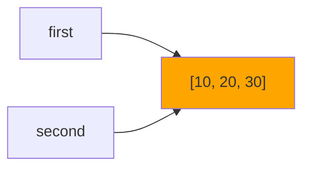
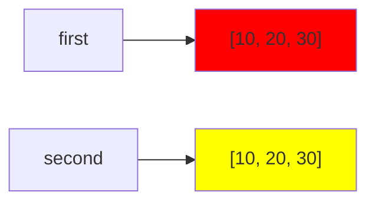
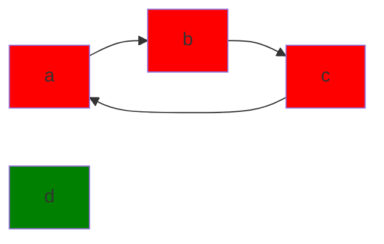

# Цель работы
Исследовать связь между именами и объектами, понять различия между присваиванием, поверхностным и глубоким копированием, а также познакомиться с механизмами управления памятью в CPython.

# Задание 1
  ## Эксперимент A
   ### Ожидаемый резултат: после выполнения инструкции a += 1 будет создан новый объект, поэтому id(a) поменяется
   ### Значение, связанное с именем b не изменилось, потому что при выполнении инструкции a += 1 в памяти был создан новый объект, так как int является неизменяемым типом
   #### 
  ## Эксперимент B
   ### Ожидаемый результат: после выполнения инструкции second.append(30) список first так же изменится
   #### 
   ### Дополнения
   #### 
   ### Схема связей между именами и объектами до переназначения

   ### Схема связей между именами и объектами после переназначения

 ## Практическая задача
 ### 

## Вопросы для анализа
 1. Меняет ли присваивание `second = first` сам объект? 
 
       Ответ: Нет, объект не меняется, а создаётся новое имя, которое ссылается на тот же самый объект, что и `first`.
 2. Почему операция над неизменяемым объектом приводит к связыванию имени с другим объектом?

       Ответ: Поскольку объект неизменяемый, чтобы выполнить операцию создаётся новый объект, к которому имя и привязывается.
 3. Как определить, что два имени обозначают один объект?

       Ответ: Можно использовать is или сравнить id(): `first is second` или `id(first) == id(second)`

# Задание 2
 ## Изменение 1 
 
 
 ## Изменение 2
 

 ## Таблица наблюдений

 | Операция | Новый внешний объект | Новые вложенные объекты | Изменения независимы |
|---|---|---|---|
| Присваивание |**нет**|**нет**|**нет**|
| Поверхностная копия |**да**|**нет**|**нет**|
| Глубокая копия |**да**|**да**|**да**|

## Создание матриц

Объяснение: операция `*` не создаёт новых объектов, она лишь повторяет ссылки на один и тот же объект, поэтому в первом случае меняются сразу три элемента. Во втором случае использован цикл `for`, каждая итерация которого создаёт новый объект, поэтому изменяется только 1 элемент.

## Вопросы для анализа
 1. Чем поверхностная копия отличается от глубокой?
 
       Ответ: Поверхностная копия (.copy()) создаёт новый внешний объект, но копирует ссылки на вложенные объекты. Глубокая копия (.deepcopy()) создаёт новые внешние и вложенные объекты.
 2. Почему глубокое копирование не следует применять автоматически ко всем объектам?

       Ответ: При глубоком копировании создаются полные дубликаты всех данных, что приводит к избыточному потреблению памяти.
 3. В каких случаях достаточно поверхностной копии?

       Ответ: В том случае, если в дальнейшем не планируется менять вложенные объекты.

# Задание 3

 - `sys.getrefcount()` показывает на одну временную ссылку больше, потому что в момент вызова функции создаётся ещё одна ссылка на объект
 - Счётчик увеличивают следующие инструкции: `alias = data`(новое имя, указывающее на тот же объект); `container = [data]`(список сохраняет ссылку на объект)
 - Счётчик уменьшают следующие инструкции: `del alias`(удаляется имя, ссылавшееся на объект); `container.clear()`(список очищается и перестаёт хранить ссылку на объект)
 - `del alias` удаляет имя, потому что так работает функция `del`, ведь один объект может иметь несколько имён и удалять объект по одному из них нецелесообразно

Эксперимент со слабой ссылкой: 

Слабая ссылка не продлевает жизни объекта, потому что это ссылка, которая не увеличивает счётчик, поэтому когда счётчик обнуляется слабая ссылка не мешает объекту удалиться.

Пример использования слабых ссылок: сбор данных, который не мешает удалить объект, когда он станет не нужен.

## Практическая задача

## Вопросы для анализа
 1. При каком условии подсчет ссылок позволяет освободить объект?
 
       Ответ: Когда удалены все имена, указывающие на объект, очищены или удалены все списки, в которых содержались ссылки на объект, завершили работу все функции, которым в качестве аргумента был передан объект.
 2. Всегда ли освобождение Python-объекта означает немедленный возврат памяти операционной системе?

       Ответ: Не всегда, если объект занимает немного памяти, то она сохранится в Python, если ж объект был большим, то память вернётся ОС.
 3. Чем сильная ссылка отличается от слабой?

       Ответ: Тем, что слабая ссылка не увеличивает счётчик и не продлевает жизнь объекта.

# Задание 4

4) Подсчёта ссылок недостаточно, потому что при возникновении циклических ссылок после удаления внешних имён всё равно остаются вложенные ссылки.

5) Поколения нужны для того, чтобы оптимизировать работу сборщика мусора. Благодаря этому временные файлы будут удаляться быстро, а долгоживущие объекты избегут постоянной проверки и траты времени и памяти.

## Дополнительный эксперимент

## Практическая задача

## Схема графа

## Вопросы для анализа
 1. Как возникает циклическая ссылка?
 
       Ответ: Цикличсеская ссылка возникает, когда два или более объектов ссылаются друг на друга.
 2. Почему объект с ненулевым счетчиком ссылок иногда может быть недостижим из программы?

       Ответ: Это происходит из-за циклических ссылок, когда удалены имена, но циклические ссылки не дают счётчику обнулиться.
 3. Зачем сборщик мусора разделяет отслеживаемые объекты по поколениям?

       Ответ: Поколения нужны для того, чтобы оптимизировать работу сборщика мусора. Благодаря этому временные файлы будут удаляться быстро, а долгоживущие объекты избегут постоянной проверки и траты времени памяти.

 
